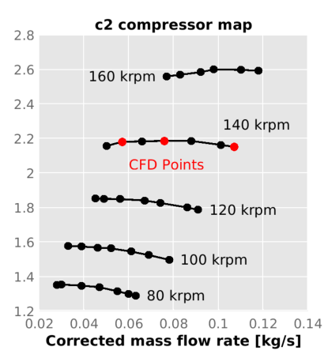
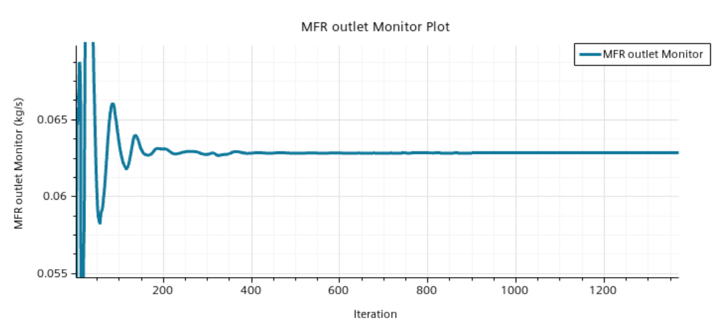
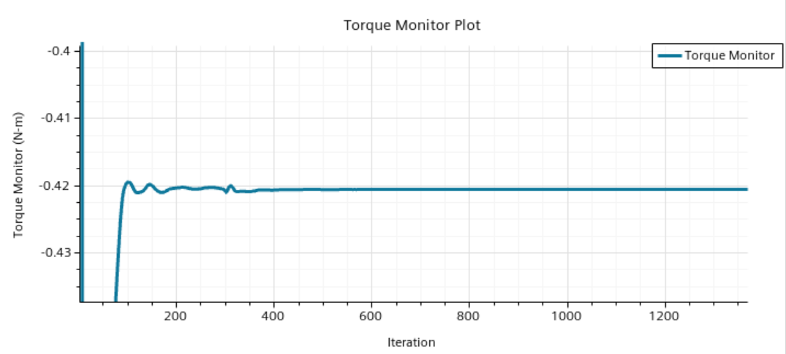
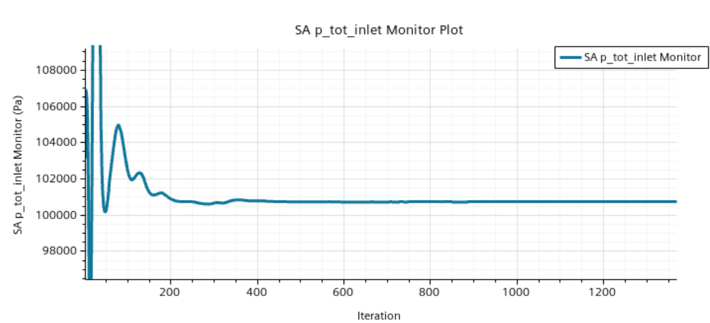
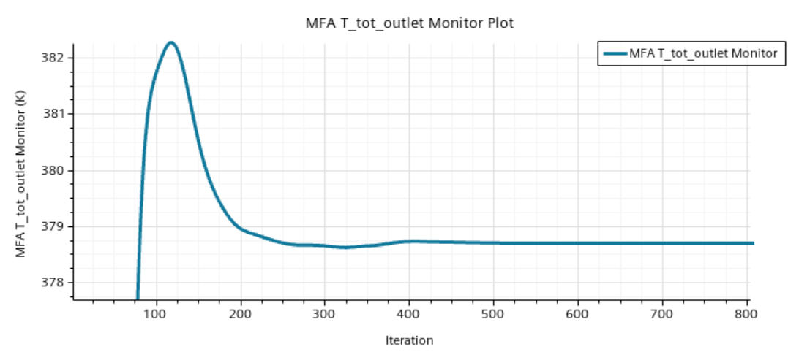
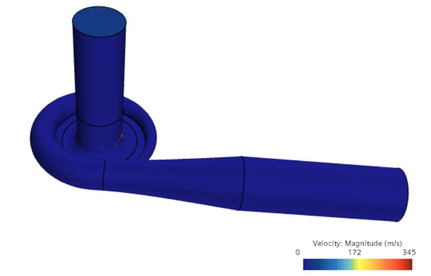
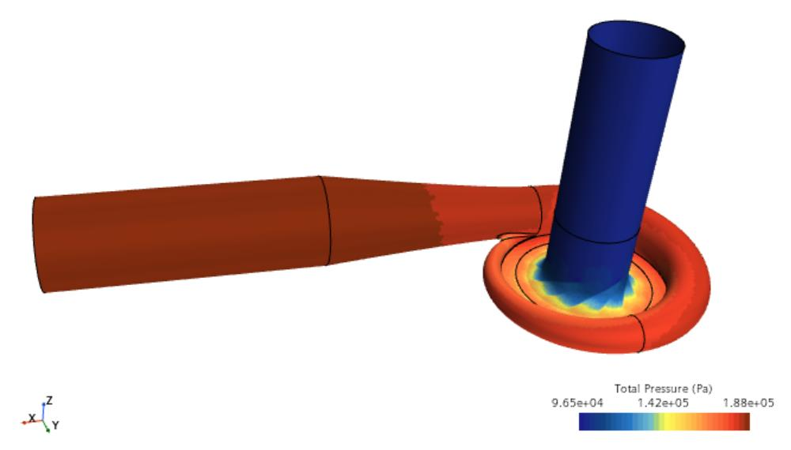
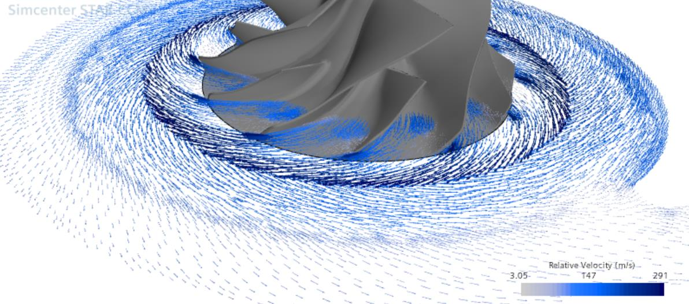
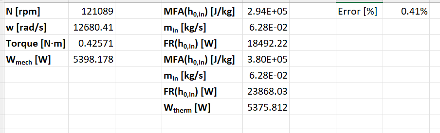
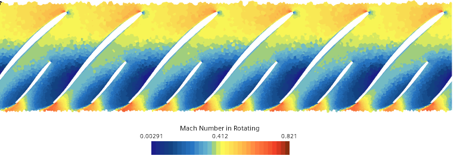

# Centrifugal Compressor CFD: MRF to RBM (STAR-CCM+)

CFD modelling of a scanned, real centrifugal compressor (impeller + volute-diffuser) operating at 121,089 rpm
(middle CFD point of the 140 krpm speed line). Course project, MSc in Computational Fluid Dynamics, UPV
(*Modelling of Turbomachinery*, lab session 2, May 2026).

**Author:** Nieves Castellanos Arnáez

> The CAD geometry was provided by the course and cannot be shared; it is not included in this repository.
> Only results and post-processing figures are shown, with the instructor's permission.

## Workflow

1. **Geometry preparation.** The single scanned body was split with CAD Boolean operations into three regions
   (inlet duct, rotor, volute-diffuser) connected by interfaces, and an outlet duct (3 diameters) was extruded.
2. **Meshing.** Polyhedral mesh with prism layers (~202k cells baseline, refined mesh for final results).
   Prism layers were disabled on interfaces, inlet and outlet.
3. **Physics.** Steady 3D RANS, k-ω SST, ideal gas, segregated flow and segregated energy.
   Rotor modelled with a **Moving Reference Frame (MRF)** and **mixing-plane interfaces**.
4. **Boundary conditions.** Mass-flow inlet (0.0628 kg/s, T0 = 293.4 K), pressure outlet (1.855 bar), adiabatic walls.
5. **Convergence strategy.** The first attempt diverged. It was solved by running an intermediate point at half the
   target conditions with continuity initialisation, then switching to the target values with
   **linear under-relaxation-factor ramps**, plus temperature and pressure limits as a safeguard.
6. **Transient case (RBM).** Switch to implicit unsteady with a rigid body rotation of the rotor and internal
   interfaces (4° per time step, 2nd order).

## Results

### Convergence (about 450-500 iterations)

| | |
|---|---|
|  |  |
|  |  |

### Sanity checks

- Only the impeller walls have non-zero velocity in the absolute frame, and only the rotor walls rotate in the relative frame.
- Total pressure increases from inlet to outlet, as expected.

### Flow at the impeller exducer

Relative velocity vectors show flow aligned with the blade passage (no significant separation). The abrupt change
in vector direction just outside the impeller is a **numerical artefact of the mixing-plane interface**
(circumferential averaging) and disappears in the transient RBM case.

### Energy balance (refined mesh)

Mechanical power from the torque vs thermodynamic power from the stagnation enthalpy flow rate:

| | Value |
|---|---|
| Mechanical power | 5398 W |
| Thermodynamic power | 5376 W |
| **Relative error** | **0.41 %** |

### Relative Mach number at midspan

The maximum relative Mach number is about 0.8, so the **segregated solver is adequate** (no need for the coupled solver).

## Tools

Simcenter STAR-CCM+, k-ω SST, MRF and RBM, mixing-plane and internal interfaces.
