# Turboprop: Parametric Geometry, Domains and Meshing (STAR-CCM+)

Preparation of a turboprop (propeller + spinner + nacelle) for CFD: geometry cleaning, parametric blade number and
pitch, split into fixed and rotating domains, hybrid meshing, and set-up of two rotating-machinery approaches
(**MRF** and **RBM**). Course project, MSc in Computational Fluid Dynamics, UPV
(*Geometry Generation and Meshing Techniques*, 2025/26).

**Authors:** Nieves Castellanos Arnáez, Julio Gómez San Juan, Sam Laguna Kalínina
**Presentation (in Spanish):** [`report/Turboprop_presentacion_final.pdf`](report/Turboprop_presentacion_final.pdf)

> The original CAD part was provided by the course and is not included in this repository.
> This project covers geometry preparation, meshing and solver set-up. It does not include flow results.

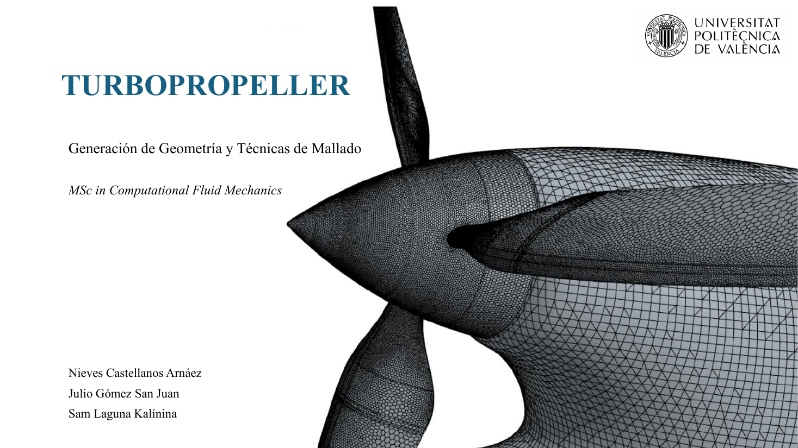

## Objectives

- Obtain a valid, **parametric geometry** (number of blades and blade pitch as design parameters).
- Generate computational domains that separate the **rotating zone** (spinner and blades) from the fixed zones.
- Implement and compare **MRF** (Moving Reference Frame) and **RBM** (Rigid Body Motion).
- Apply optimised **hybrid meshing** techniques.

## Geometry preparation

The imported part contained internal machinery, holes and a nozzle of almost zero thickness, so it had to be cleaned
and closed. The final model is about 2.75 m long.

- **Clean, closed interior** with an inlet and a pressure-outlet surface defined as boundary conditions.
- **Parametric blades:** a circular pattern controls the number of blades and a rotation controls the pitch angle.
- **Nozzle thickness:** the nozzle of infinitesimal thickness was solved by trimming the model to a shorter length
  (2.85 m to 2.75 m).
- **Spinner extension:** a smooth lofted transition behind the spinner keeps the blades inside the rotating mesh section.

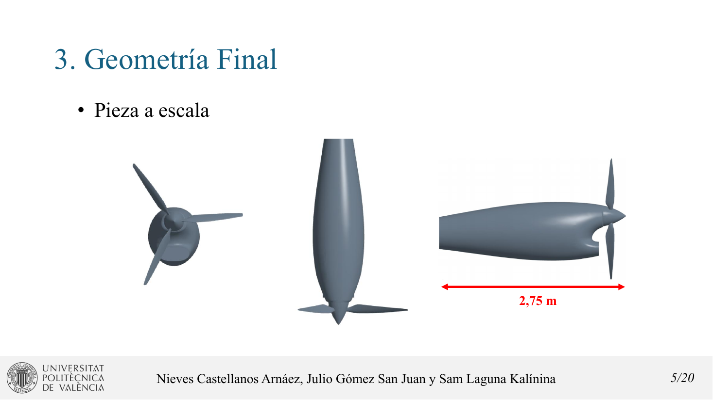
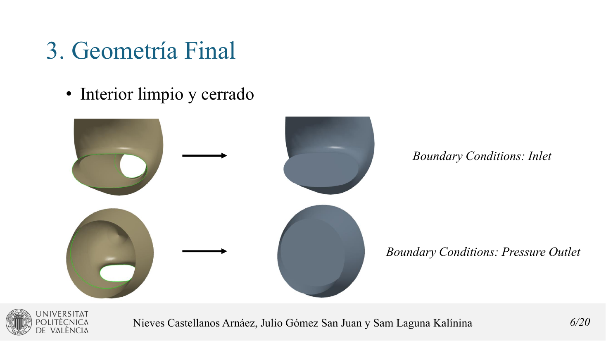

| Number of blades | Blade pitch |
|---|---|
| 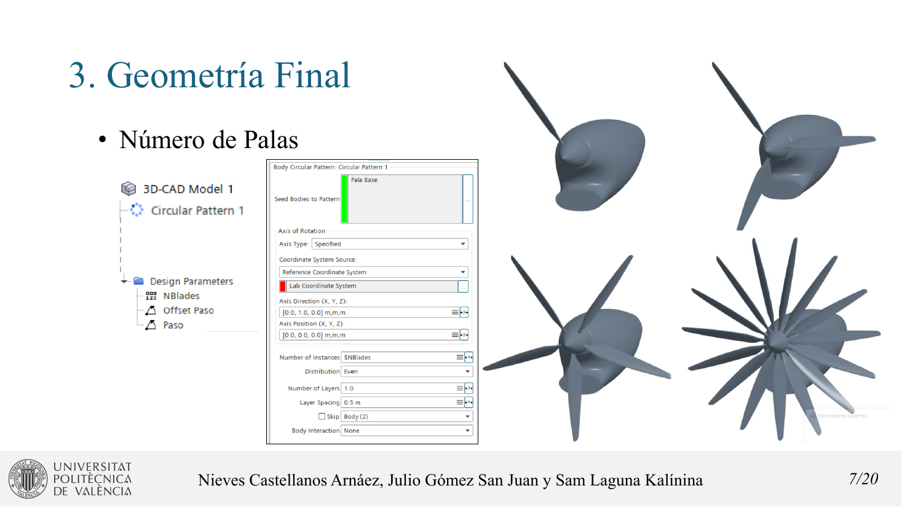 | 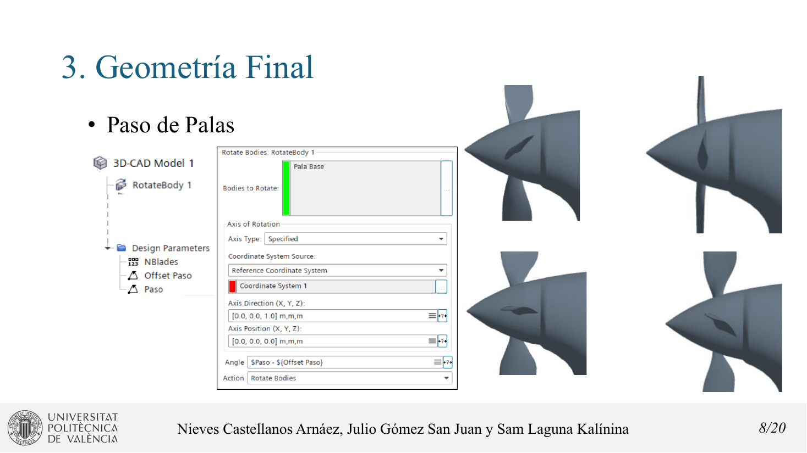 |

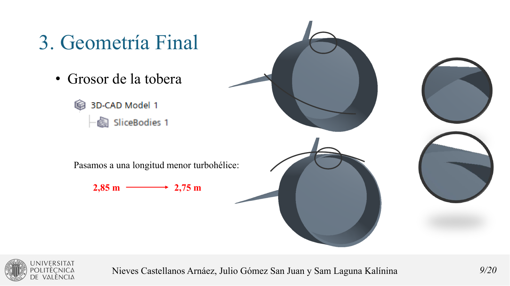
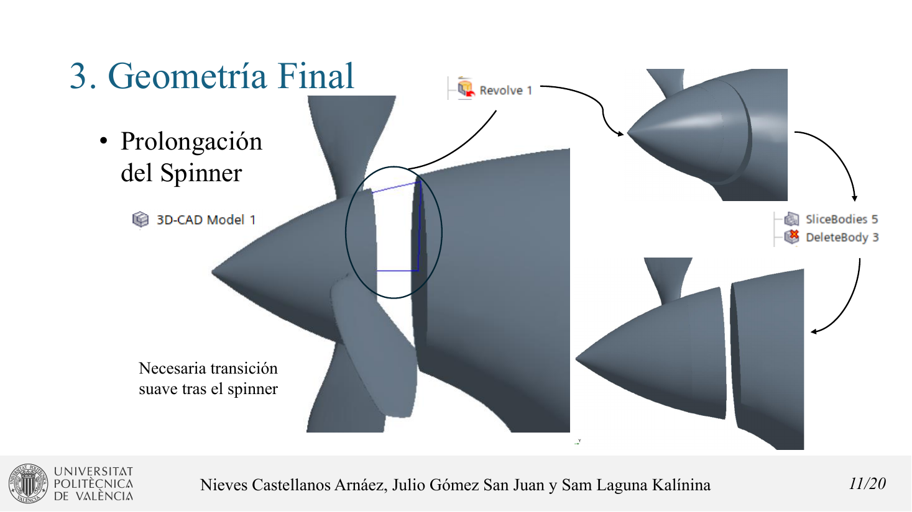

## Domains and meshing

The domain was split with Boolean subtract operations into a **fixed fluid domain** and a **rotating domain**, each
meshed independently.

- **Fixed mesh:** surface remesher, automatic surface repair and trimmed-cell mesher, with surface refinement and a
  wake refinement behind the blades.
- **Rotating mesh:** surface remesher, polyhedral mesher, thin mesher and prism layer mesher, with surface control on
  the blades and spinner.

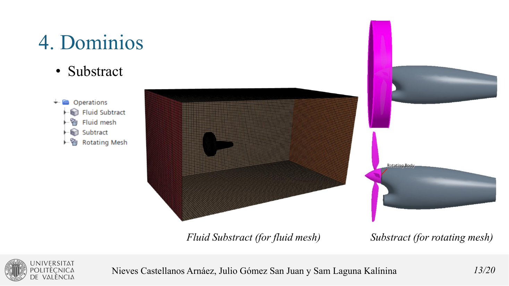
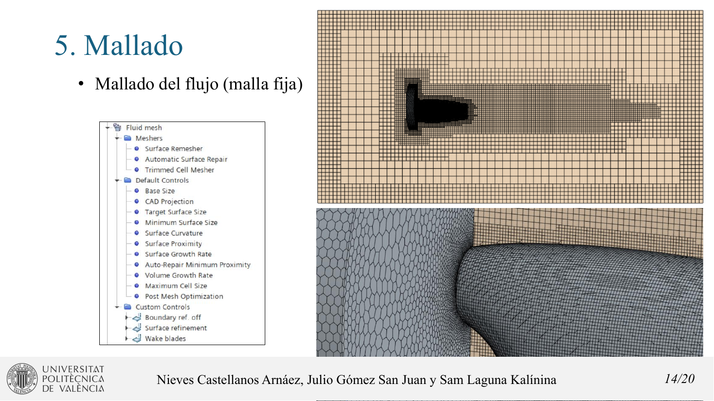
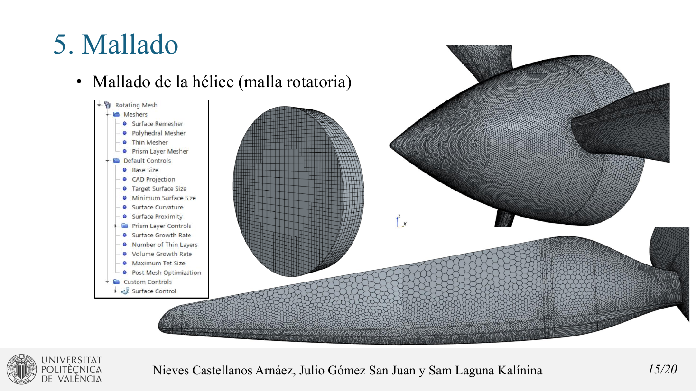

## MRF and RBM set-up

| MRF (steady) | RBM (transient) |
|---|---|
| 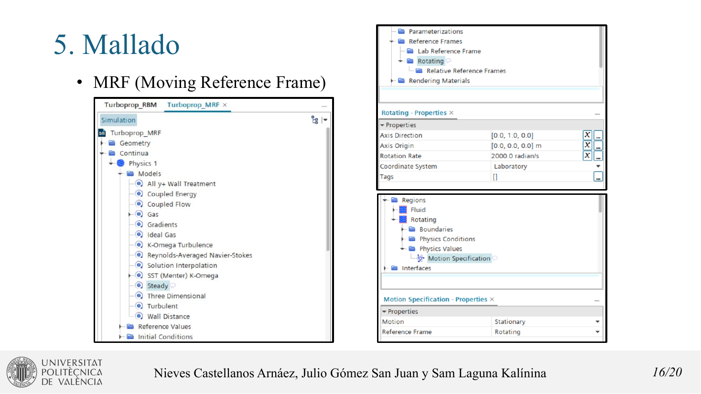 | 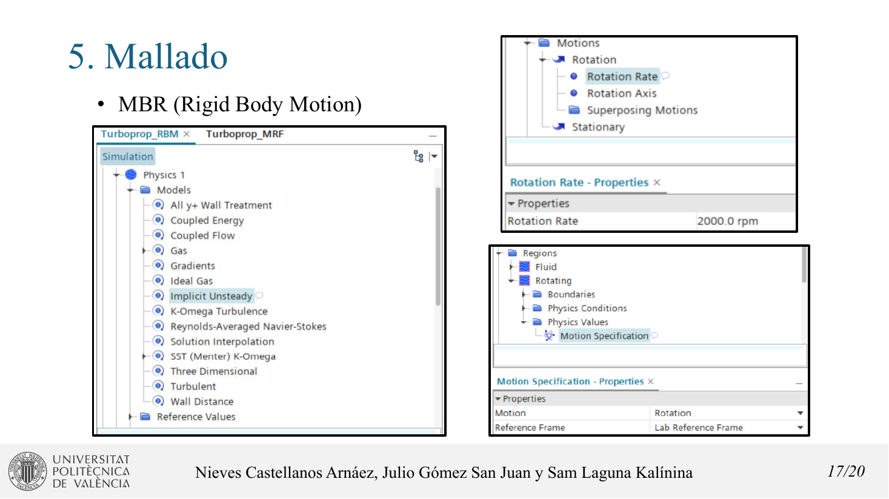 |

Both cases use coupled flow and energy, an ideal gas, and SST k-ω with all-y+ wall treatment. MRF assigns the
rotating reference frame to the rotating region (steady). RBM uses a rotation motion with the lab reference frame
(implicit unsteady).

- **MRF:** suitable for steady analysis at lower computational cost, valid for design conditions.
- **RBM:** needed to capture transient effects and rotor/stator interaction, with higher accuracy but higher cost.

## Tools

Simcenter STAR-CCM+ (3D-CAD, Boolean operations, automated mesh, MRF and RBM).
