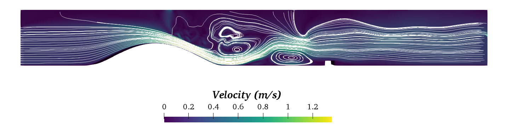
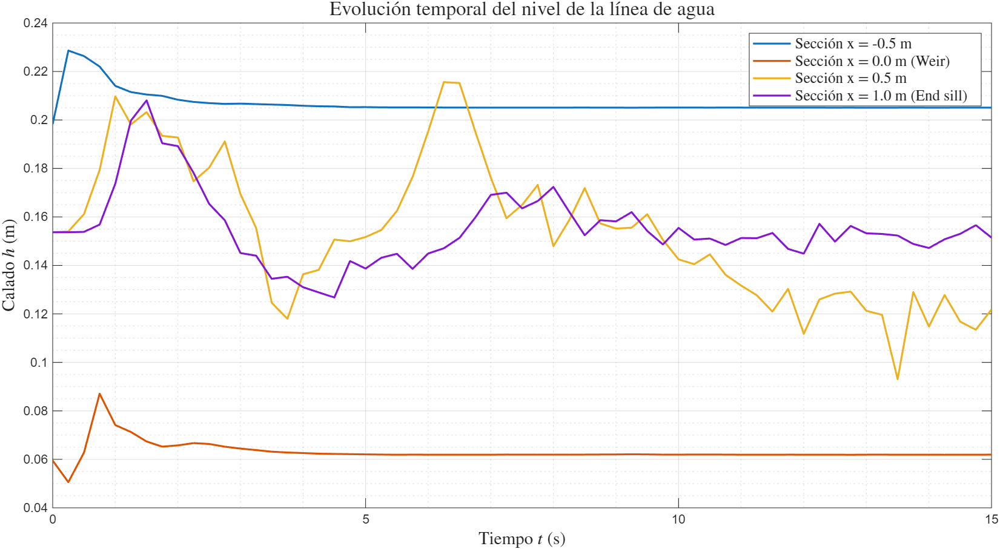
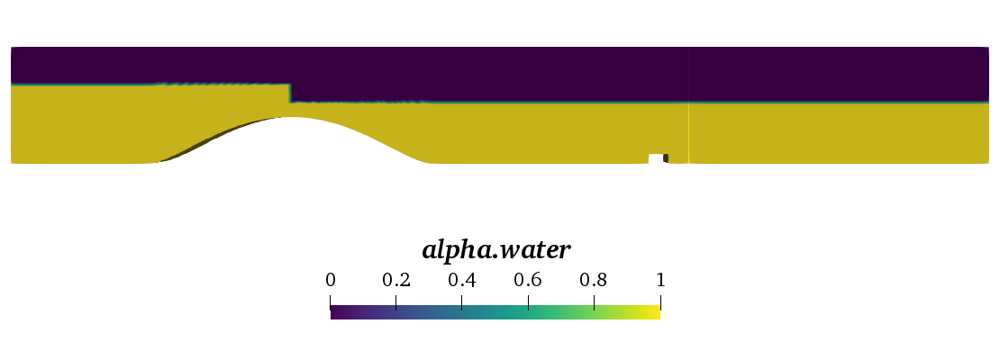
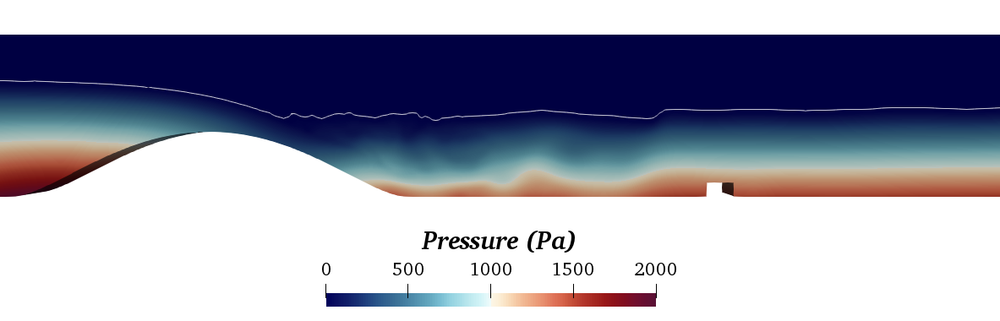

# Hydraulic Jump over an Ogee Weir (OpenFOAM, interFoam)

Two-dimensional, two-phase (air-water) CFD model of subcritical flow over an ogee weir, a supercritical chute and a
downstream hydraulic jump stabilised by an end sill. Course project, MSc in Computational Fluid Dynamics, UPV
(*Atmospheric Aerodynamics*, laboratory session 2, April 2026).

**Author:** Nieves Castellanos Arnáez
**Full report:** [`report/Lab2_AtmosphericAerodinamics_Nieves_Castellanos.pdf`](report/Lab2_AtmosphericAerodinamics_Nieves_Castellanos.pdf)

## Setup

| | |
|---|---|
| Solver | OpenFOAM `interFoam` (VOF), PIMPLE, adjustable time step with Co ≤ 0.3 |
| Turbulence | RANS k-ω SST with wall functions |
| Mesh | Structured quadrilateral cells, Δx = 0.005 m |
| Geometry | Weir height H = 0.117 m, width a = 3H; end sill (teeth 0.050 × 0.025 m) at x = 0.90 m |
| Inlet | h₁ = 0.20 m, U₁ = 0.25 m/s (Fr = 0.13, subcritical) |
| Outlet | Hydrostatic pressure with h₂ = 0.154 m (Fr = 0.26, subcritical) |
| Fluids | Water (ρ = 1000, ν = 1e-6) and air (ρ = 1.25, ν = 1.5e-5), σ = 0.07 N/m |
| Run time | 15 s |

## Results

### Water depth at four sections

Upstream (x = -0.5 m) and crest (x = 0 m) sections settle quickly, with the crest depth near the critical depth.
The two downstream sections (x = 0.5 m and 1.0 m) stay unsteady, as expected inside and after the jump roller.
The jump has not reached a fully periodic state in 15 s, so longer runs would be needed for time-averaged statistics.

### Flow structure

The flow accelerates down the chute (above 1.2 m/s, about five times the inlet velocity) and a surface roller plus a
secondary vortex near the floor form before the end sill. The estimated roller length is about 0.50 m.

### Pressure and vorticity

Pressure is hydrostatic away from the weir (about 2000 Pa on the upstream floor, in line with ρgh₁ = 1962 Pa) and
clearly non-hydrostatic along the chute and in the jump. Vorticity is concentrated in the shear layer along the chute,
at the toe of the jump and at the end sill.

### Wall y+

y+ is mostly between 30 and 171 on the weir and floor, inside the range where wall functions apply. Values below 30
appear in low-velocity zones (far upstream and downstream of the jump).

## Baseline case files

The folder [`baseline_case/`](baseline_case) contains OpenFOAM dictionaries (`0/`, `constant/`, `system/`) for this problem.

> **Note:** these files are an earlier, simplified **baseline version** of the setup. The mesh (`blockMeshDict`)
> models the weir as a rectangular step with no end sill, while the results above come from the final case with the
> ogee profile (Eqs. 1-3 of the report) and the end sill, whose files were not preserved. The boundary conditions,
> fluid properties, turbulence model and solver settings are otherwise the same. The `blockMeshDict` is adapted from
> the OpenFOAM `weirOverflow` tutorial and the course guide.

## Limitations

- Δx = 0.005 m is too coarse to resolve air entrainment in the roller.
- A finer near-wall mesh or a low-Reynolds model would improve y+ in the low-velocity regions.
- The roller length was estimated visually and not compared quantitatively with Hager's correlation.

## Tools

OpenFOAM v2306, ParaView, MATLAB (plots), Linux.
