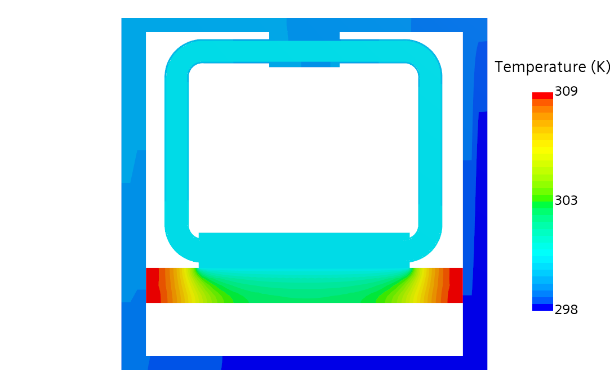
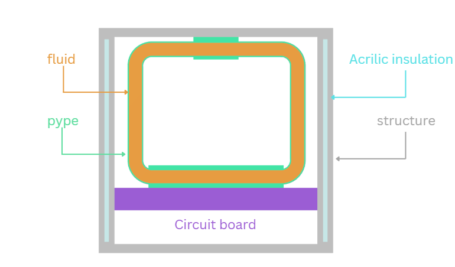
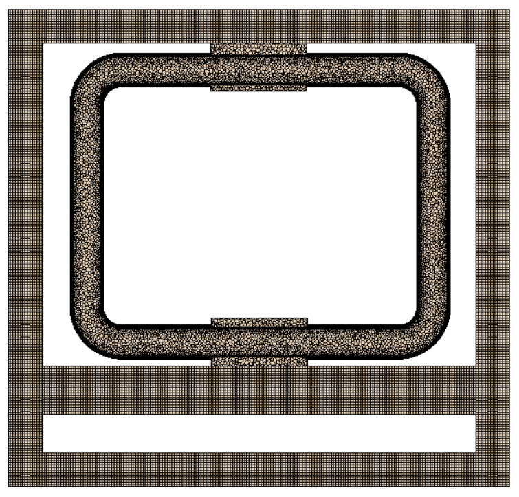
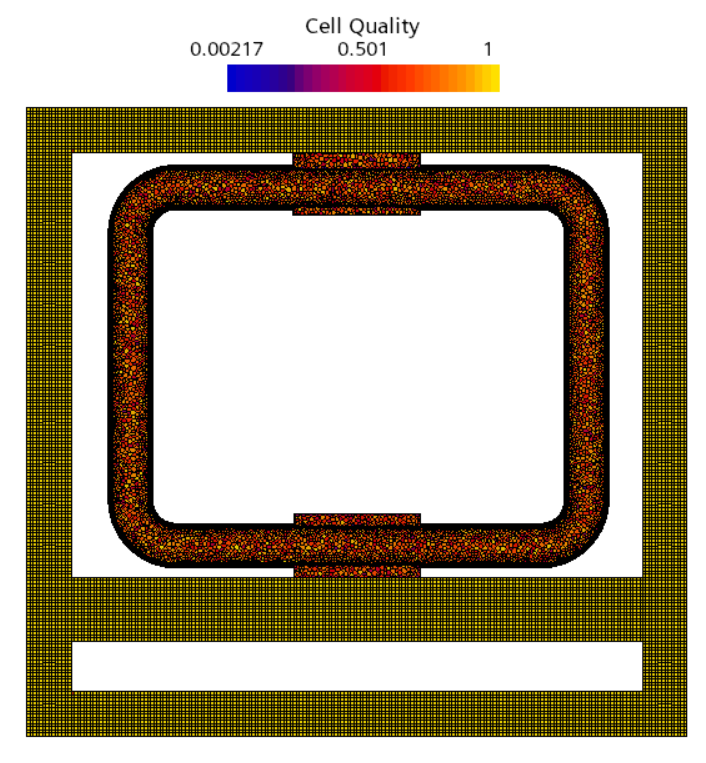
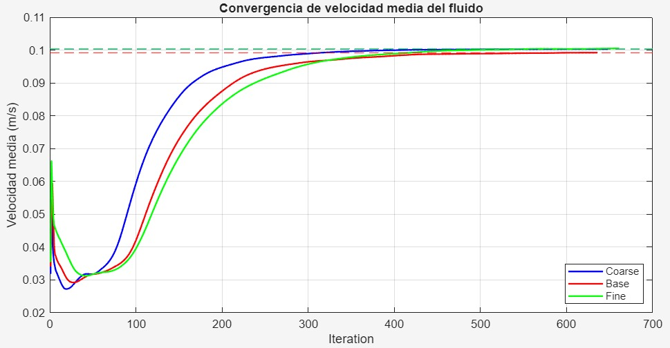
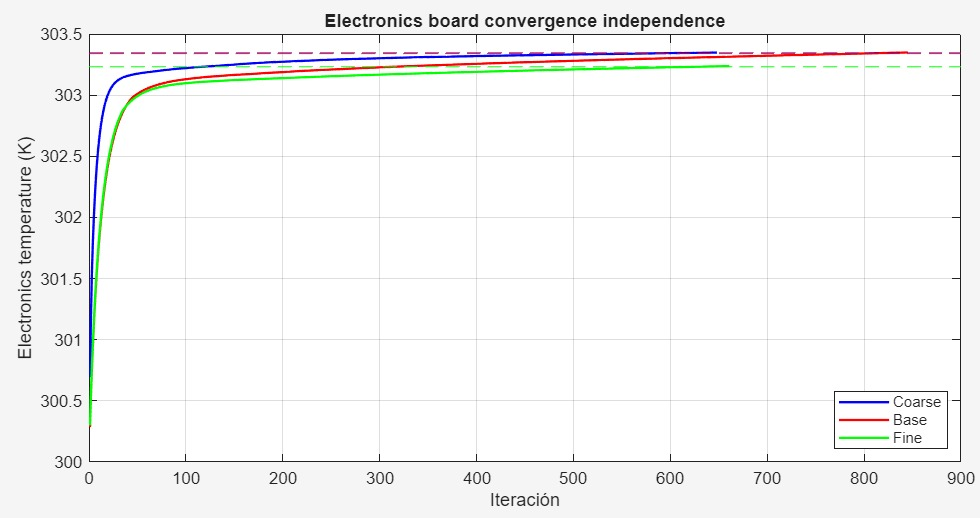
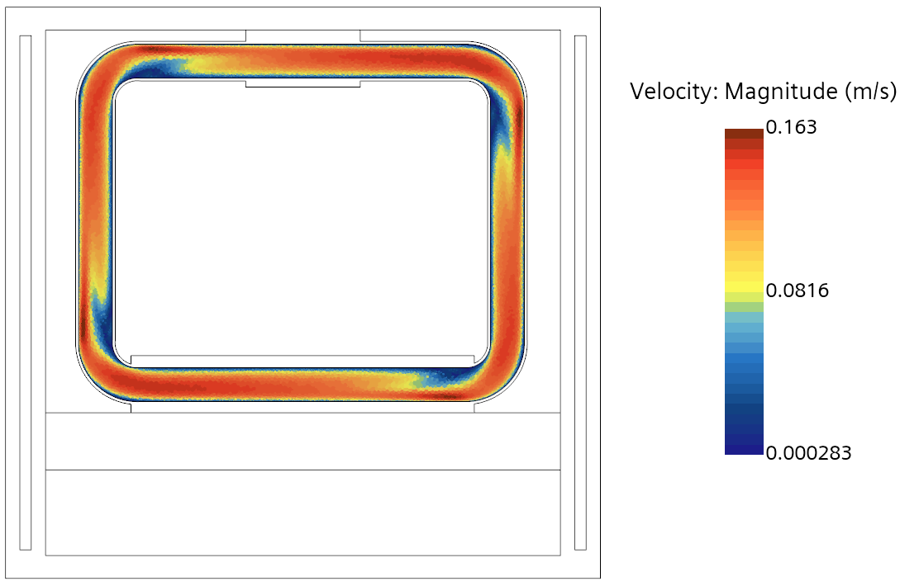
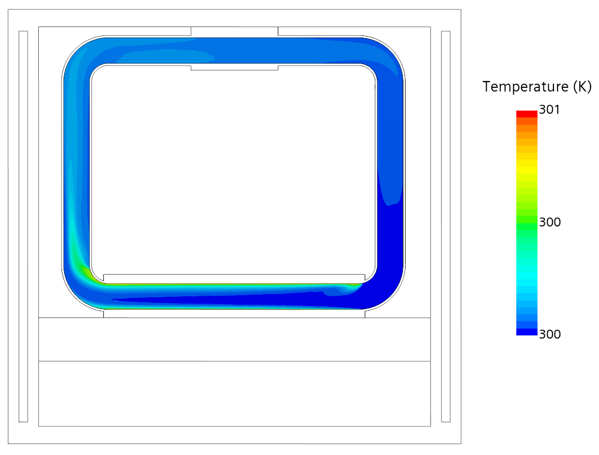
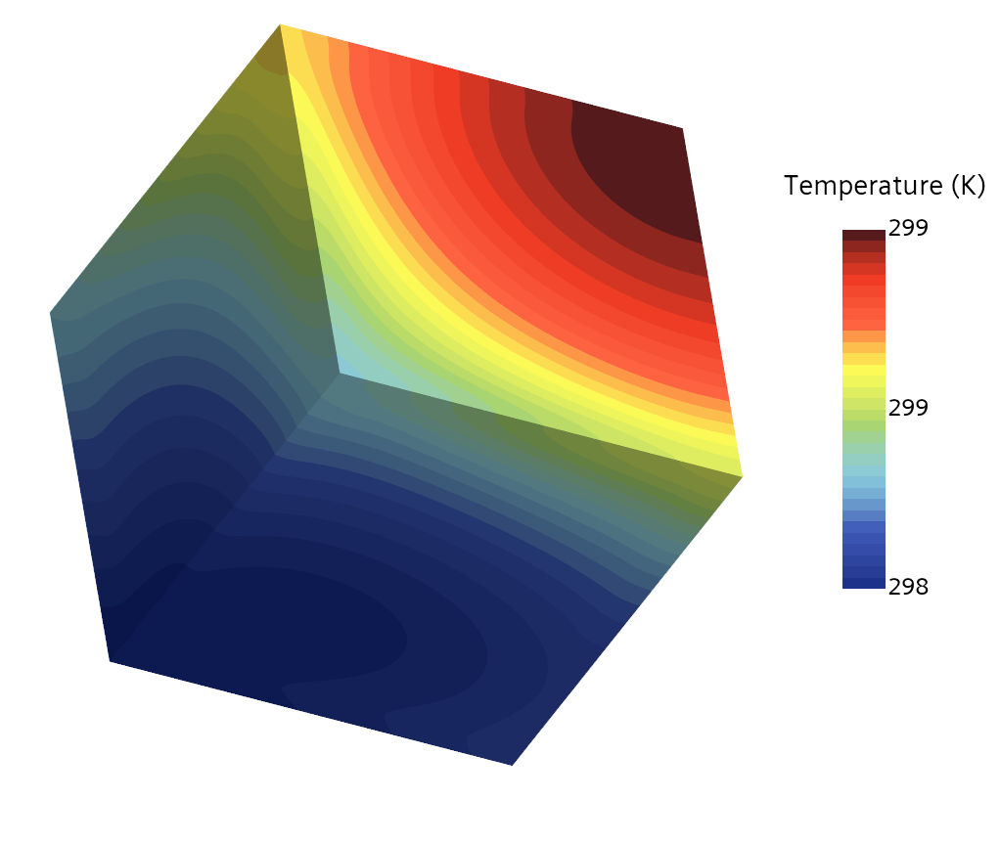

# Thermal and CFD Analysis of a Small Satellite Cooling System (STAR-CCM+)

Conjugate heat transfer (CHT) model of a CubeSat with an **active single-phase liquid cooling loop** during the sunlit
phase of a low Earth orbit (LEO). The model resolves conduction, convection and radiation at the same time.
Course project, MSc in Computational Fluid Dynamics, UPV (academic year 2025/26).

**Authors:** Nieves Castellanos Arnáez, Fabio Ferro, Mattia Giusto, Julio Gómez San Juan
**Presentation:** [`report/satellite_cooling_presentation.pdf`](report/satellite_cooling_presentation.pdf)

## Objectives

1. **Thermal check:** verify the electronics board stays within -20 °C to +60 °C under 1 W of internal heat and solar
   loading (408 W/m²).
2. **Fluid characterisation:** velocity distribution in the closed loop and efficiency of the heat extraction.
3. **Solar asymmetry:** thermal response of the aluminium chassis to the directional solar input.

## Model

- **Components:** aluminium frame (main conduction path), acrylic insulation on three faces, a perimeter cooling loop
  coupled through four mounting brackets, and a central board with a 1.0 W uniform volumetric heat source.
- **Fluid and solids:** steady laminar single-phase liquid with the coupled fluid-energy solver, and steady
  conduction in the solids.
- **Solver:** pressure-based segregated solver (SIMPLE), second-order upwind for momentum and energy, incompressible liquid.
- **Space environment:** no convection; radiation to a 3 K sink using Stefan-Boltzmann user field functions,
  q_net = α·G_solar − σ·ε·(T⁴ − T_space⁴), with α = 0.30, ε = 0.85 and G_solar = 1360 W/m² (408 W/m² absorbed on one
  exposed face). For a uniform background sink this is equivalent to S2S at much lower cost.
- **Virtual pump:** no impeller is modelled. A volumetric momentum source of 200 N/m³ aligned with the local flow
  direction drives the loop, which avoids sliding meshes or MRF.

## Mesh

Hybrid strategy: trimmed-cell mesher for the solids, thin mesher plus polyhedral mesher for the thin pipe wall, and
prism layers with a polyhedral core for the fluid.

### Mesh independence

| Mesh | Cells | Board T [K] | Fluid velocity [m/s] |
|---|---|---|---|
| Coarse | 1,034,055 | 303.345 | 0.1003 |
| **Medium (selected)** | 2,610,128 | 303.341 | 0.0992 |
| Fine | 5,799,488 | 303.232 | 0.1004 |

From medium to fine, the velocity changes by about 1.2 % and the board temperature by 0.11 K, so the medium mesh was
used for production.

| Mean fluid velocity | Board temperature |
|---|---|
|  |  |

## Results

- **Board temperature:** about 303.3 K (≈ 30 °C) in the mesh study, with a peak of about 309 K at the lateral
  extremities of the board. Both are well below the +60 °C limit.
- **Coolant:** typical velocity of 0.12-0.14 m/s in straight channels, with a local peak of 0.163 m/s at the outer
  radii of the 90° bends, and a total coolant temperature rise below 1 K.
- **Solar asymmetry:** the sun-exposed panel reaches about 299.5 K against about 298 K on the shadowed panels, a
  gradient of about 1.5 K across the chassis.
- **Design insight:** near-zero velocity at the inner radii of the bends, so brackets should not be placed there
  (rounded corners or guide vanes could help).

| Fluid velocity | Fluid temperature |
|---|---|
|  |  |

## Limitations and future work

Steady sunlit case only (no eclipse), solar panels omitted, and a single heat source in place of the real electronics.
Future work: transient orbital cycling (sunlit and eclipse phases) and higher-emissivity coatings.

## Tools

Simcenter STAR-CCM+ (trimmed, thin, polyhedral and prism-layer meshers, conjugate heat transfer, user field functions).
