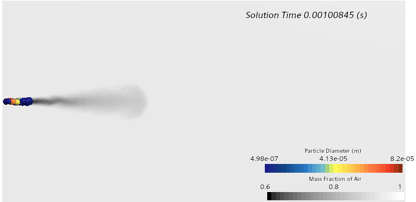
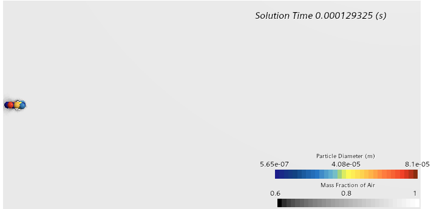
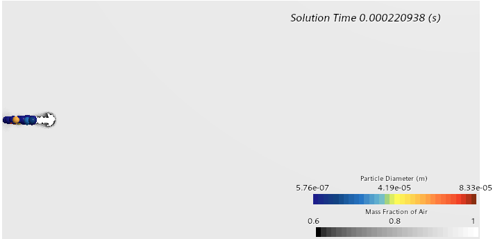
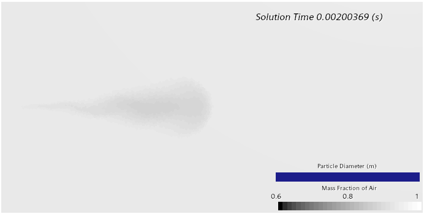
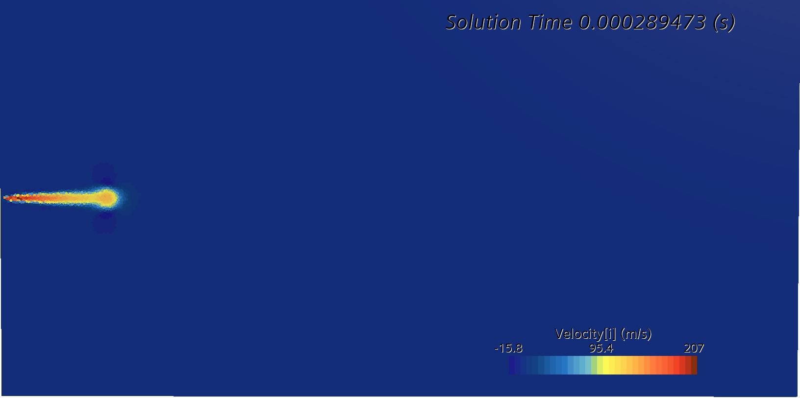
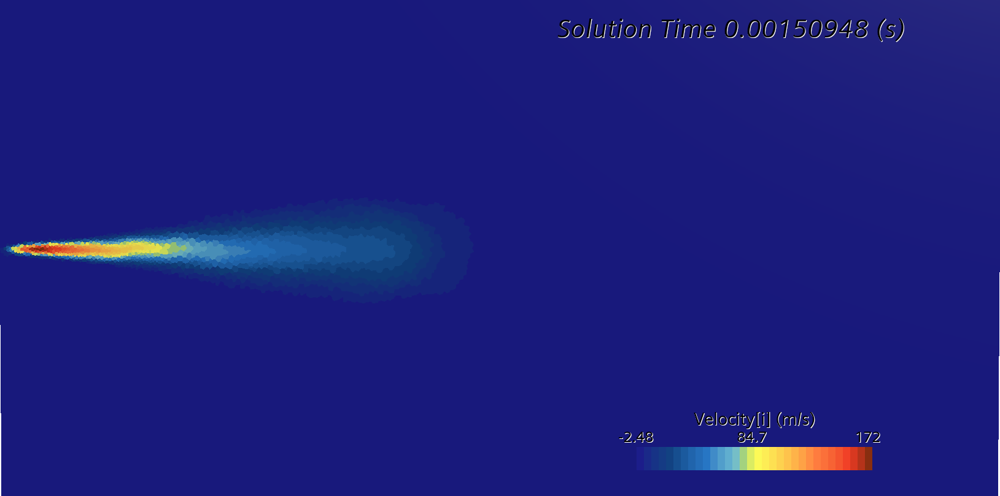
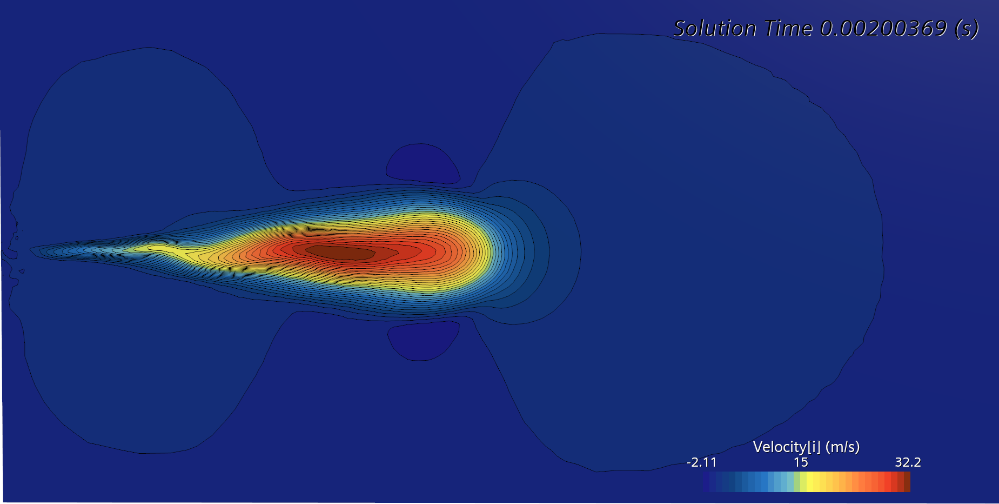
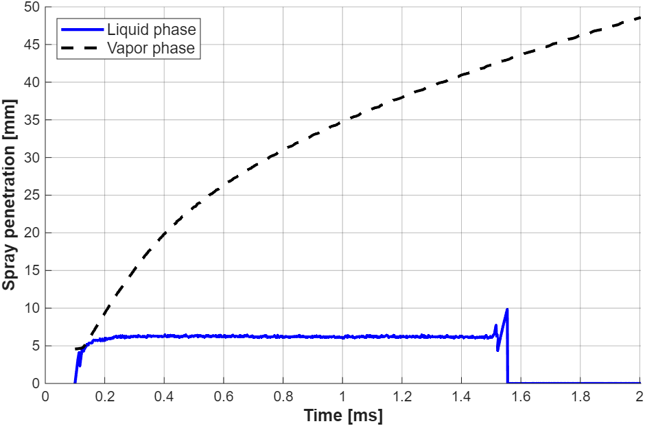
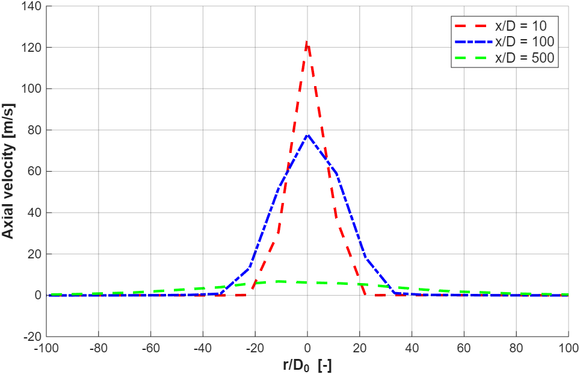

# Spray A: Euler-Lagrange Simulation of a High-Pressure Diesel Spray (STAR-CCM+)

Discrete Droplet Model (DDM) simulation of the Engine Combustion Network (ECN) **Spray A** nozzle. Course project,
MSc in Computational Fluid Dynamics, UPV (*Multiphase Flows*, laboratory session 4).

**Authors:** Julio Gómez San Juan, Nieves Castellanos Arnáez
**Report:** [`report/Spray_A_Euler_Lagrange_report.pdf`](report/Spray_A_Euler_Lagrange_report.pdf)

## Set-up

| | |
|---|---|
| Nozzle | Single hole, d₀ = 0.09 mm, injection pressure 150 MPa, n-dodecane (diesel surrogate) |
| Ambient (assigned) | 7 MPa, 733.33 K (differs from the ECN nominal 900 K and 6 MPa, so different liquid length and penetration are expected) |
| Framework | Euler-Lagrange DDM: gas phase (air plus dodecane vapour) with RANS and standard k-ε, liquid as Lagrangian parcels |
| Coupling | Two-way coupling of momentum, energy and mass, plus parcel collisions (NTC model) |
| Atomisation | Huh primary atomisation; KH-RT secondary breakup |
| Other models | Quasi-steady evaporation, spherical drag law, turbulent dispersion |
| Domain and mesh | Cylinder of 25 mm radius and 100 mm length, polyhedral mesh with two conical refinement zones (0.25 and 0.5 mm), about 324,000 cells |
| Solver | PISO unsteady, adaptive time step (mean CFL 0.5), 2 ms of physical time |

Liquid and vapour penetration are monitored with the ECN 99 % criterion.

## Results

### Spray evolution

Large parent parcels and small child droplets coexist near the nozzle from the first instants. A vapour halo appears
by about 0.22 ms, which shows that evaporation is active early because of the high ambient enthalpy. After the end of
injection the vapour cloud disperses by diffusion and residual momentum.

| 0.13 ms | 0.22 ms |
|---|---|
|  |  |
| **1.0 ms** | **2.0 ms** |
|  |  |

### Velocity field

The jet core reaches up to 207 m/s at 0.29 ms, with a thin negative-velocity fringe at the edges that marks air
entrainment. By 1.5 ms the momentum region is wider and more diffuse, and after injection ends the velocity range
collapses to about 32 m/s.

### Penetration and radial profiles

- **Liquid penetration** rises steeply during the first 0.2 ms and then stays at a quasi-steady liquid length, where
  evaporation balances the liquid mass flux. It is shorter than typical ECN results at lower ambient density because of
  the higher aerodynamic drag at 7 MPa.
- **Vapour penetration** grows throughout the injection, reaching about 47 mm at 2 ms with no plateau.
- **Radial velocity profiles** at x/D₀ = 10, 100 and 500 (t = 1.5 ms): peak of about 120 m/s, then about 65 m/s, then
  about 8 m/s. Most of the injected momentum is transferred to the ambient within the first 100 diameters.

## Limitations

No quantitative comparison with ECN experimental data was made, and the ambient conditions differ from the ECN
nominal ones. The x/D₀ = 1 profile is not shown because it lies in the injector region. A small numerical artefact
appears in the liquid curve near the end of injection.

## Tools

Simcenter STAR-CCM+ (Lagrangian multiphase, Huh and KH-RT breakup), MATLAB (plots).
