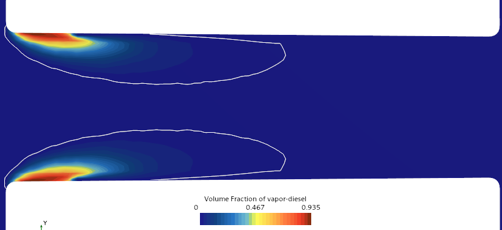
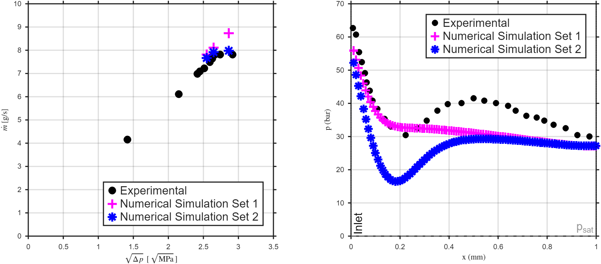
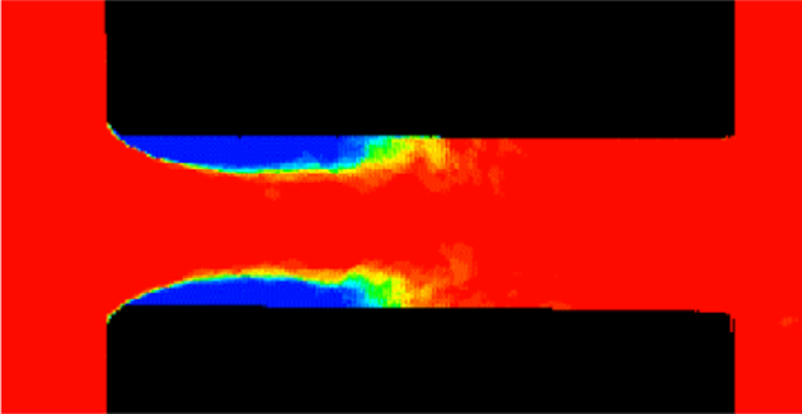
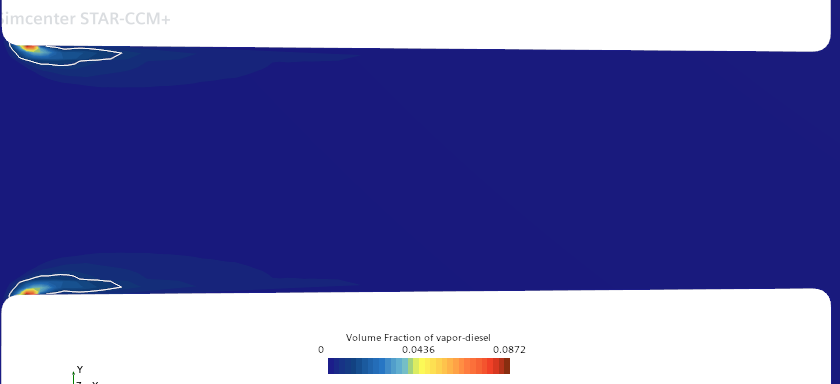
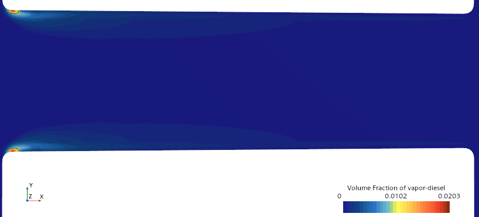
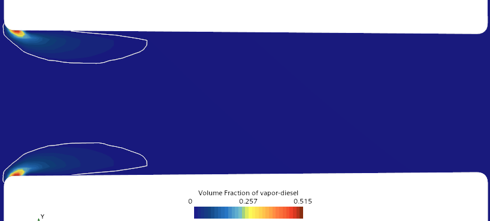
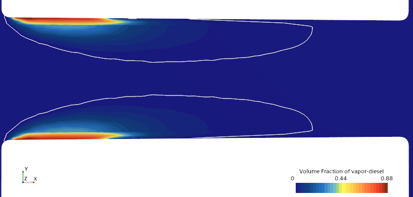
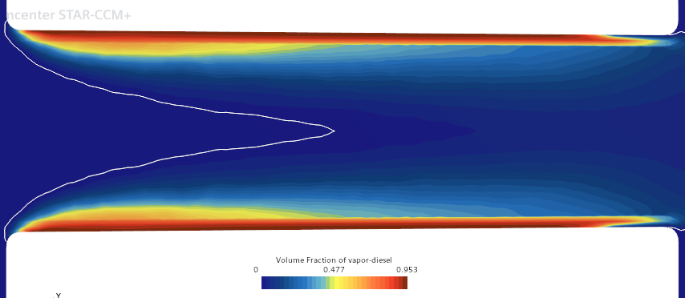

# Internal Flow Cavitation in a Throttle Nozzle (STAR-CCM+)

Steady 2D RANS simulation of cavitation in the **Winklhofer et al. throttle "U" nozzle** with the Schnerr-Sauer model,
comparing standard and tuned model parameters against experiments. Course project, MSc in Computational Fluid
Dynamics, UPV (*Multiphase Flows*, laboratory session 2).

**Authors:** Julio Gómez San Juan, Nieves Castellanos Arnáez

## Set-up

| | |
|---|---|
| Geometry | Converging channel: inlet width 300 µm, outlet 284 µm, length 1 mm, inlet rounding radius 20 µm. Half of the 2D domain is meshed (symmetry), with large upstream and downstream plenums |
| Model | Steady 2D RANS, k-ε, VOF framework without surface tension (closer to a mixture model) |
| Cavitation | Schnerr-Sauer model, derived from the Rayleigh-Plesset equation |
| Fluid | Diesel at 300 K (liquid ρ = 830 kg/m³, p_sat = 2000 Pa) |
| Operating points | Inlet pressure 10 MPa and back pressures of 1.8, 3.0 and 3.5 MPa |
| Set 1 | Standard parameters (F⁺ = F⁻ = 1) |
| Set 2 | Tuned parameters (F⁺ = 5, F⁻ = 1), calibrated against the experimental cavitation field at 3 MPa |

## Results

### Mass flow rate and centreline pressure

Both sets give a mass flow rate in reasonable agreement with the experiments. Set 1 slightly overpredicts it at high
Δp, consistent with almost no cavitation. Set 1 has a smooth pressure decay with a minimum of about 27-28 bar, far
above the saturation pressure, while Set 2 predicts a sharper drop (about 17 bar minimum). Neither set reproduces the
experimental pressure recovery, a known limitation of steady RANS.

### Vapour field at 3 MPa back pressure

Set 1 produces almost no vapour (maximum vapour fraction 0.087). Set 2 gives a vapour pocket about 0.45-0.5 mm long
along the wall, in good qualitative agreement with the experiment. The experimental image is a time-averaged
transmittance field, so a quantitative comparison with steady CFD is limited.

| Experimental | Set 1 (F⁺ = 1) | Set 2 (F⁺ = 5) |
|---|---|---|
|  |  |  |

### Effect of back pressure

Cavitation grows in extent and intensity as the pressure difference increases. At 1.8 MPa the vapour pocket takes up a
significant part of the nozzle, which reduces the effective flow area and starts to choke the flow.

| 3.5 MPa, Set 1 | 3.5 MPa, Set 2 |
|---|---|
|  |  |
| **1.8 MPa, Set 1** | **1.8 MPa, Set 2** |
|  |  |

Maximum axial extent of the vapour bubble (mm from the nozzle inlet):

| | 3.5 MPa | 3.0 MPa | 1.8 MPa |
|---|---|---|---|
| Set 1 (F⁺ = 1) | 0.035 | 0.14 | 0.76 |
| Set 2 (F⁺ = 5) | 0.3 | 0.56 | 1.5 |

## Conclusions and limitations

The Schnerr-Sauer model in a VOF-RANS framework reproduces the hydraulic behaviour of the nozzle with reasonable
accuracy. Standard parameters are enough for the mass flow rate but underpredict cavitation inception, which the
report attributes to insufficient mesh resolution at the sharp inlet corner. Raising F⁺ compensates for it. Because
F⁺ was calibrated at 3 MPa, the other two back pressures show consistent trends but are not an independent
validation. The results show how sensitive cavitation models are to near-wall resolution.

## Tools

Simcenter STAR-CCM+ (VOF, Schnerr-Sauer cavitation model, k-ε), MATLAB (plots).
