# VOF Filling of a Tank: Mesh and Time-Step Sensitivity (STAR-CCM+)

Volume of Fluid (VOF) simulation of a water jet filling a cubic tank, comparing a coarse mesh, a fine mesh and a fine
mesh with **Adaptive Mesh Refinement (AMR)**. Course project, MSc in Computational Fluid Dynamics, UPV
(*Multiphase Flows*, laboratory session 3).

**Authors:** Julio Gómez San Juan, Nieves Castellanos Arnáez
**Report:** [`report/VOFFOT_report.pdf`](report/VOFFOT_report.pdf)

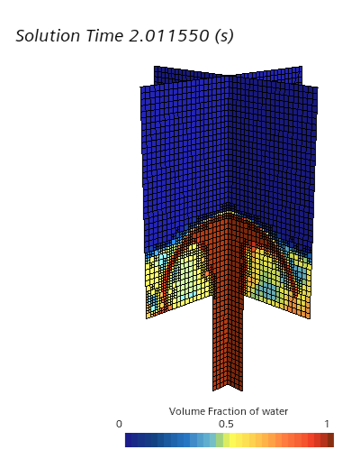

## Set-up

| | |
|---|---|
| Case | Cubic tank of 1 m side filled through a square inlet pipe of 0.2 m side |
| Flow | Water at 2.2 m/s into quiescent air, surface tension 0.072 N/m, contact angle 90° |
| Meshes | Coarse (Δx = 0.05 m), fine (0.025 m) and fine with AMR (minimum 0.0125 m at the interface) |
| Interface | VOF with the HRIC scheme (compressive for Co ≤ 1.0, blended with upwind up to Co = 1.2), surface tension with the CSF model |
| Time stepping | First-order implicit, adaptive time step with a free-surface CFL limit of 0.2 |
| Flow regime | Laminar, although the jet Reynolds number is about 4.4 × 10⁴ (a known limitation) |

## Results

### Interface smearing

The coarse mesh smears the interface over several cells, which makes the surface tension force lose its meaning. The
fine mesh improves it and AMR gives the sharpest interface.

| Coarse | Fine | AMR |
|---|---|---|
| 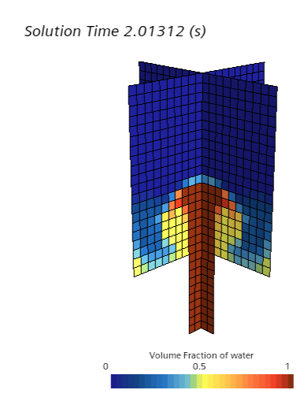 | 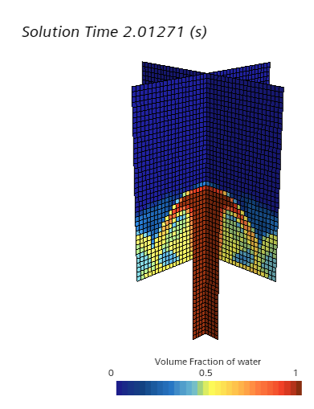 |  |

### Flow structure

The jet decelerates at the free surface and turns its axial momentum into radial spreading. Displaced air
recirculates down the tank walls in a large toroidal vortex.

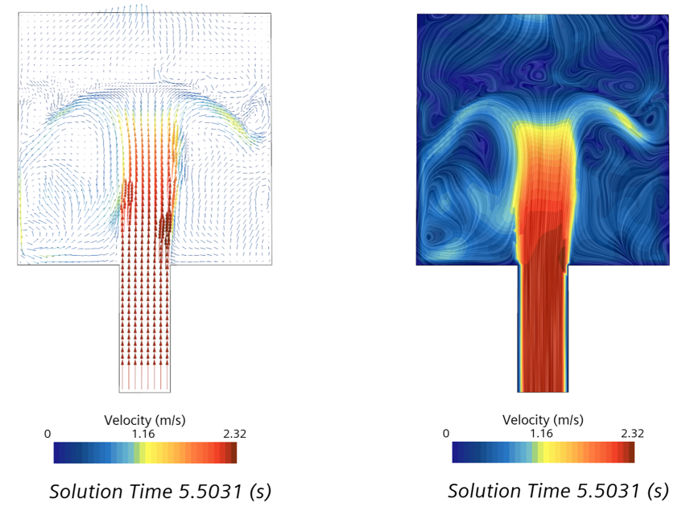

| t = 2 s | t = 3 s | t = 5.5 s |
|---|---|---|
| 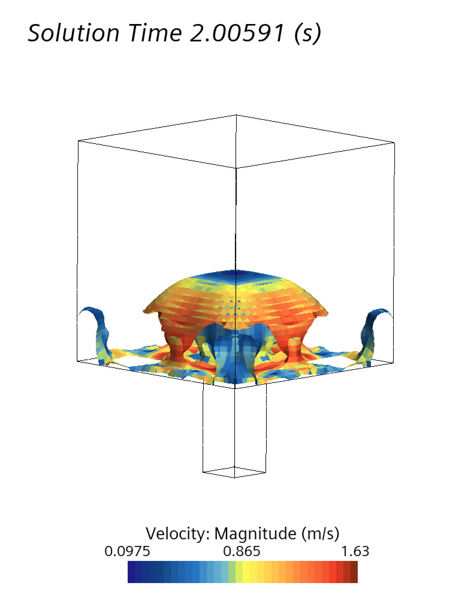 | 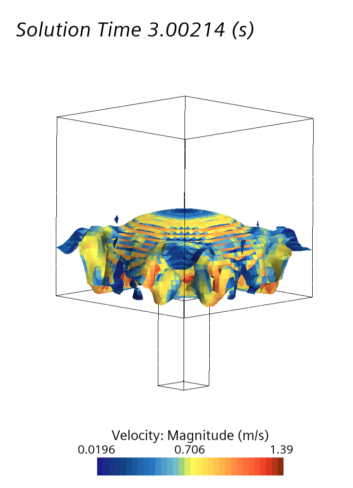 | 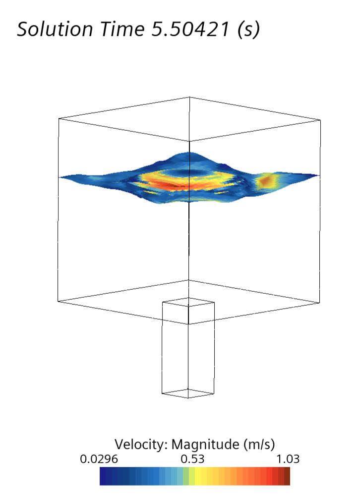 |

### Penetration and interface thickness

Meshes agree at first. Later the coarse mesh overestimates penetration (up to about 15 % relative to AMR) because the
diffuse field advances the α = 0.5 marker. The interface spans 3-4 cells on the coarse mesh and 1-2 on the AMR mesh.

| Jet penetration | Axial α profile |
|---|---|
| 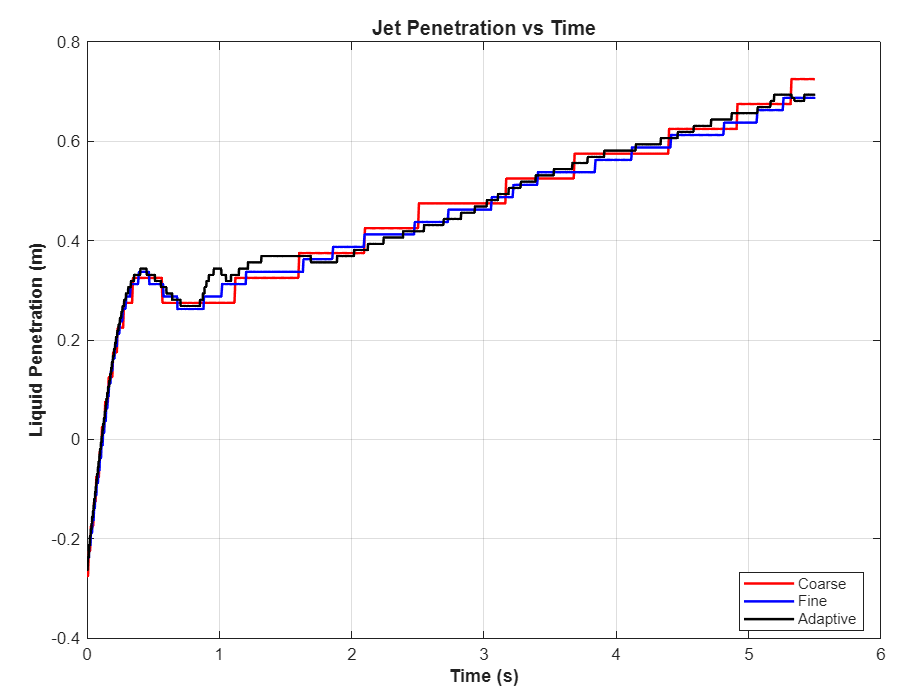 | 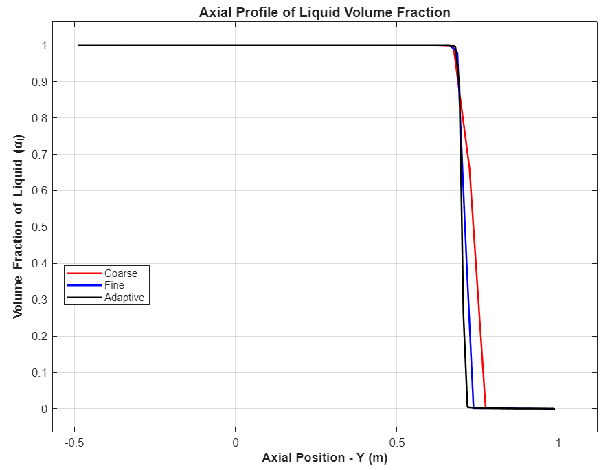 |

### Courant number and time step

The Courant number spikes when the jet and the crown hit the free surface. The time step reaches its lower bound and
the solver cannot reduce it further, which forces the scheme back to diffusive upwind and smears the interface even on
the AMR mesh.

| Maximum Courant number | Time step |
|---|---|
| 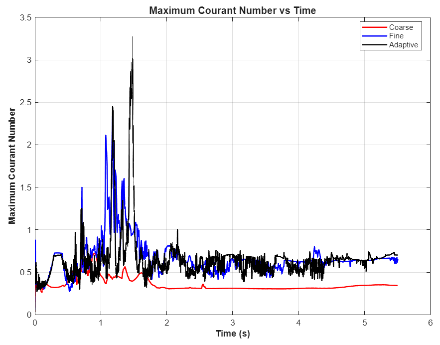 | 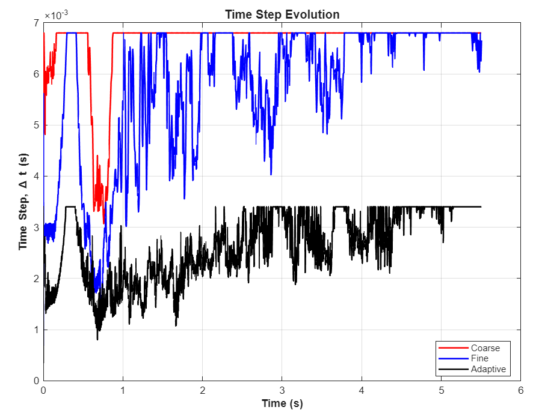 |

## Conclusions

1. AMR sharpens the interface to 1-2 cells at modest extra cost, so it is the recommended option when interface
   quality matters.
2. Temporal resolution matters as much as spatial resolution. A lower minimum time step (the report suggests a factor
   of 5-10) would avoid the Courant exceedances.
3. The laminar assumption is inconsistent with the jet Reynolds number, so a turbulence model would improve the
   splashing dynamics. Mass conservation was kept in all cases.

## Tools

Simcenter STAR-CCM+ (VOF, HRIC, AMR, adaptive time stepping), MATLAB (plots).
