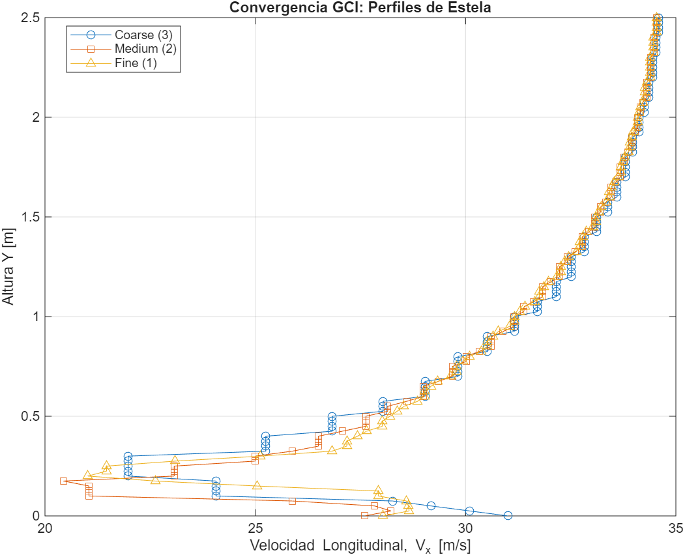
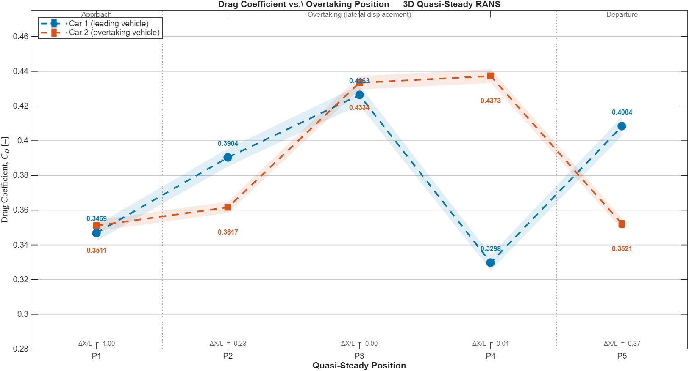
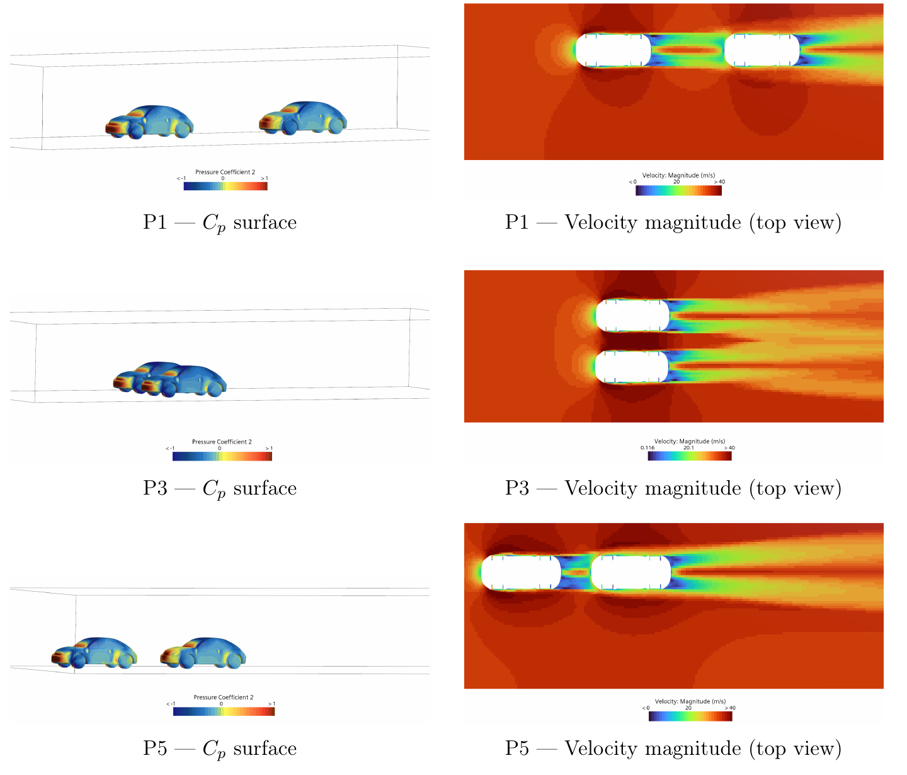
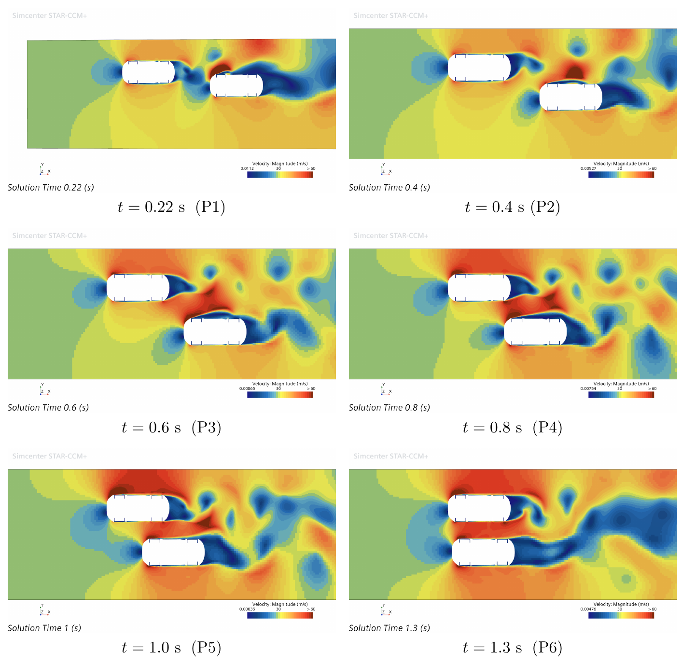
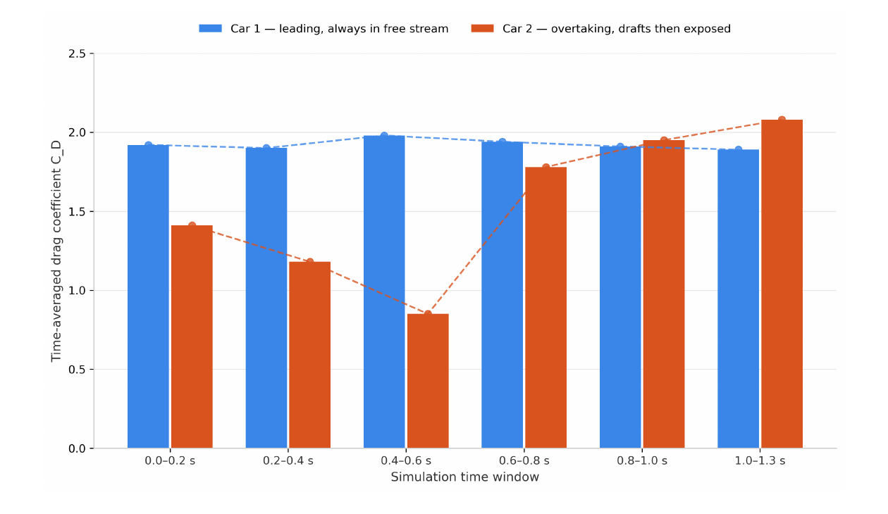

# 08 · Aerodynamics of a vehicle overtaking manoeuvre: quasi-steady 3D vs transient 2D CFD

Group project (Group 12) for the MSc in Fluid Mechanics, Universitat Politècnica de València, June 2026.

**Team:** Damián Armas Vicente · Nieves Castellanos Arnáez · Pablo Lozano Hernandez
**Tools:** STAR-CCM+ (Simcenter), LaTeX
**Report:** [`report/Vehicle_Overtaking_CFD_Report.pdf`](report/Vehicle_Overtaking_CFD_Report.pdf)

## Objective

Assess whether a **2D transient overset simulation** can act as a reliable and cheap surrogate for a **3D quasi-steady parametric analysis** of an overtaking manoeuvre. The reduced frequency of the problem (β ≈ 0.10, following Greitzer et al.) sits at the edge of the quasi-steady regime, which is what motivates the comparison.

## Set-up

| | 3D quasi-steady | 2D transient overset |
|---|---|---|
| Geometry | Defeatured VW Beetle 2016 (L = 3.4 m, W = 1.4 m, H = 1.2 m), two cars | Each car as a rectangular bluff body in top view |
| Cases | 5 discrete positions (P1–P5, see below) | Full manoeuvre, 1.3 s |
| Reference frame | Fixed to Car 2 (U∞ = 33.33 m/s, 120 km/h); Car 1 surfaces carry a tangential velocity of 5.55 m/s | Galilean transformation: inlet at Car 1 speed (27.78 m/s), Car 2 translates at ΔU = 5.56 m/s |
| Domain | 20 × 7 × 3 m, slip walls on lateral and top faces, moving ground | Rectangular domain, slip walls top and bottom |
| Mesh | Trimmed hexahedral, 3 prism layers, 30 ≲ y⁺ ≲ 300. Coarse level (457 443 cells) used for all positions | Trimmed cells, overset regions around each car, volumetric-control strip along the overtaking corridor, 5 prism layers |
| Turbulence | Realizable k-ε (k-ω SST did not converge on P3, see report Annex A) | Realizable k-ε |
| Solver | Steady, incompressible, SIMPLE, 2nd-order upwind | Implicit Unsteady, Δt = 1×10⁻⁴ s, initialised from the steady P1 solution |

The five 3D positions:

| Case | ΔX/L | ΔY/L | Description |
|---|---|---|---|
| P1 | 1.00 | 0.00 | Approach, same lane |
| P2 | 0.23 | 0.30 | Lateral displacement initiated |
| P3 | 0.00 | 0.30 | Full lateral alignment |
| P4 | 0.01 | 0.30 | Car 2 nose just ahead |
| P5 | 0.37 | 0.00 | Departure, same lane |

## Mesh independence (3D, position P1)

Dual criteria: global convergence on C_D and local convergence on the inter-vehicle V_x profile (Coarse 457 443 / Medium 825 015 / Fine 3.6M cells).

- Car 2 C_D is converged already at the Coarse level (< 0.9 % variation).
- Car 1 C_D converges non-monotonically (Coarse departs 8.4 % from Fine), so a formal three-grid GCI is not applicable. Medium and Fine differ by 0.85 %.
- V_x NRMSE between Coarse and Fine ≈ 4 %; pointwise GCI₂₁ on V_min = 2.04 %.
- The Coarse mesh was chosen for all parametric runs (5.3 vs 16.0 CPU-h). Its ≈ 8 % error on Car 1 C_D is accepted because the study relies on relative trends across positions.



## Key results

### 3D quasi-steady: drag vs position

| Case | C_D Car 1 | C_D Car 2 |
|---|---|---|
| P1 | 0.347 | 0.351 |
| P2 | 0.390 | 0.362 |
| P3 | 0.426 | 0.433 |
| P4 | 0.330 | 0.437 |
| P5 | 0.408 | 0.352 |

Three phases: approach (P1), lateral displacement (P2–P4) where the gap restricts the flow and both drag coefficients peak at full alignment (P3, about +23 % with respect to P1), and departure (P5), where the drag distribution reverses as Car 2 leads and Car 1 sits in its wake.



Surface C_p and top-view velocity at P1, P3 and P5. At P3 the gap behaves as a convergent channel with a low-pressure corridor on the inboard flanks, the origin of the lateral attractive force.



### 2D transient overset

Velocity magnitude at six instants (0.22 to 1.3 s): gap acceleration above 60 m/s at maximum lateral proximity, then progressive wake decoupling. Pressure in the gap reaches about −4730 Pa at t = 0.22 s.



Time-averaged C_D shows the expected three-stage signature for Car 2: a 39 % drop while slipstreaming (1.40 to 0.85), a +106 % rise at the transition (0.85 to 1.75), and stabilisation after overtaking (up to 2.08).



### Comparison

The 2D model reproduces the qualitative force signature, but absolute values differ strongly (C_D ≈ 0.35–0.44 in 3D vs 1.87–2.08 in 2D). The report attributes this to the planar confinement of the 2D model (no pressure relief over the roof or underbody), so the two approaches should be compared through normalised relative trends rather than absolute magnitudes.

## Limitations

- Blockage ratio of about 16 % in the 3D domain (above the recommended 5 %).
- Realizable k-ε used instead of k-ω SST (reported accuracy penalty of ~21 % vs ~9 %).
- 3D residuals plateau at 10⁻³ to 2×10⁻³ for some equations; C_D monitors are stable (σ < 0.001 except P5 Car 2, σ = 0.0018).
- Coarse mesh error of about 8 % on Car 1 C_D (see mesh independence above).

## Repository contents

```
08-vehicle-overtaking-3d-vs-2d-overset/
├── README.md
├── report/
│   └── Vehicle_Overtaking_CFD_Report.pdf
└── figures/
```

The vehicle CAD (VW Beetle 2016, GrabCAD community model) and the STAR-CCM+ simulation files are not included.
